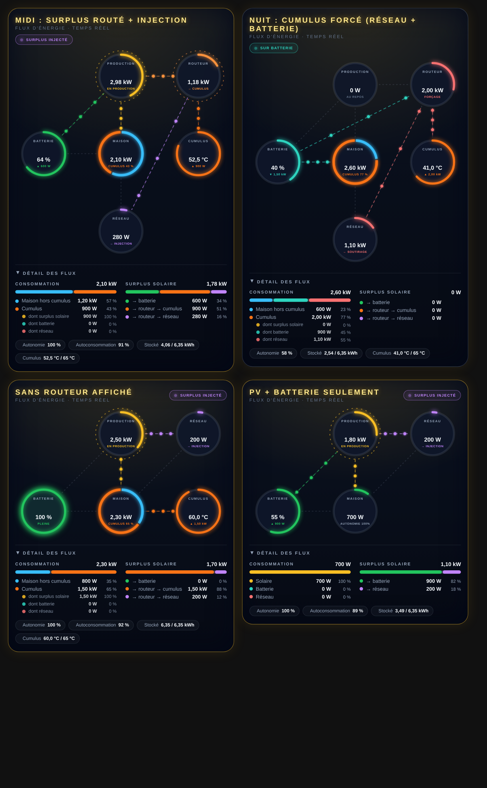

# ☀️ Solar Powerflow


Intégration Home Assistant qui calcule les **flux d'énergie** de votre installation solaire (production, maison, batterie, routeur solaire, cumulus, réseau) et fournit sa **carte animée**.

<p align="center"></p>

## ⚠️ Avertissement

Les valeurs dépendent **uniquement des informations remontées par votre onduleur, votre batterie, votre routeur et vos capteurs**, ainsi que de leur fréquence de rafraîchissement. Les capteurs mesurent la puissance de chaque appareil, pas l'origine de chaque watt : la répartition des flux est une **estimation** (voir « Calculs »). Ce n'est ni un compteur certifié, ni un outil de facturation.

## 📦 Installation

**HACS** (dépôt personnalisé, catégorie **Intégration**) ou **manuelle** : copier `custom_components/solar_powerflow` dans `/config/custom_components/`, puis redémarrer Home Assistant.

Ensuite : **Paramètres → Appareils et services → Ajouter une intégration → Solar Powerflow**.

La carte est servie et chargée **automatiquement** par l'intégration : aucune ressource à déclarer. Si l'ancienne carte `solar-powerflow-card` (v1.x) est installée en ressource de tableau de bord, **supprimez cette ressource** (Paramètres → Tableaux de bord → ⋮ → Ressources), puis rechargez la page (Ctrl+F5).

## ⚙️ Réglages

### Étape 1 · Équipements
| Case | Rôle |
|---|---|
| Batterie installée / Afficher la batterie sur la carte | |
| Routeur solaire installé / Afficher le routeur sur la carte | |
| Cumulus installé / Afficher le cumulus sur la carte | |

Un équipement coché « installé » mais pas « affiché » est **pris en compte dans les calculs** sans apparaître sur la carte.

### Étape 2 · Un onglet repliable par matériel
| Onglet | Champs |
|---|---|
| ☀️ **Photovoltaïque** | Puissance de production · Consommation totale de la maison · Puissance de l'installation (W) · La consommation inclut le cumulus · Seuil de soutirage (50 W) |
| 🔋 **Batterie** | État de charge · Puissance de charge · Puissance de décharge · Capacité (kWh) |
| 🔀 **Routeur** | Flux de surplus solaire · Flux vers le cumulus · Flux vers le réseau · Puissance du routeur (tous facultatifs) |
| ♨️ **Cumulus** | Puissance de charge (chauffe) · Température · Consigne de chauffe max (°C) |

Tout se modifie ensuite avec **Configurer** sur la fiche de l'intégration (les onglets s'ouvrent alors repliés). Les capteurs en kW sont convertis en W.

## 🗺️ La carte

```yaml
type: custom:solar-powerflow-card
```

Aucune entité à renseigner : la carte trouve l'intégration toute seule. Le **cercle central disparaît** : les flux relient directement les appareils.

| Avec routeur | Sans routeur affiché |
|---|---|
| Production → Maison, Batterie, **Routeur** · Routeur → **Cumulus**, Réseau · Batterie / Réseau → Maison | Production → Maison, Batterie, Réseau · Maison → **Cumulus** (le cumulus fait partie de la maison) |

- **Maison** : consommation totale. L'anneau est **bicolore** : bleu = maison hors cumulus, orange = cumulus ; la part du cumulus est indiquée en %.
- **Routeur** : surplus qui lui est envoyé (« → CUMULUS », « → RÉSEAU », « EN ATTENTE », « FORÇAGE » quand le cumulus chauffe sur le réseau ou la batterie).
- **Cumulus** : température, jauge remplie jusqu'à la consigne max, puissance de chauffe.
- **Détail des flux** (repliable) : consommation détaillée (maison hors cumulus / cumulus, et cumulus par origine : surplus solaire, batterie, réseau), devenir du surplus solaire, mesures brutes du routeur, autonomie, autoconsommation, énergie stockée, température.
- Un clic sur un cercle ouvre la fiche de l'entité.

Options de la carte (éditeur visuel en sections repliables) : `title`, `layout` (`standard` ou `compact`), `show_details`, `details_open`, `background`, `background_color`, `background_opacity`, `text_theme`, `card_border`, `alert_battery_full`, `battery_full_threshold`, `alert_battery_low`, `battery_low_threshold`, `alert_no_production`, `sun_entity`, `entity` (facultatif).

## 🧮 Calculs

- **Maison hors cumulus** = consommation totale − cumulus (si la case « inclut le cumulus » est cochée).
- **Surplus solaire** = production − maison hors cumulus.
- **Surplus vers le routeur** = surplus solaire − charge de la batterie par le solaire.
- La production va d'abord à la maison, puis à la batterie, puis au routeur → cumulus, et le reste au réseau.
- La décharge de la batterie va à la maison, puis au cumulus, puis au réseau. Le réseau fournit ce qui manque encore.
- **Soutirage / injection** sont déduits du bilan : aucun capteur réseau n'est nécessaire.
- Puissance du cumulus : capteur de l'onglet Cumulus, sinon « flux vers le cumulus » du routeur, sinon « puissance du routeur ».

## 📈 Capteurs créés

État · Surplus solaire · Surplus vers le routeur · Consommation hors cumulus · Cumulus chauffé par le solaire / le réseau / la batterie · Part du cumulus dans la consommation · Soutirage réseau · Injection réseau · Autonomie · Autoconsommation.
Seuls les capteurs utiles aux équipements déclarés sont créés. Le capteur **État** porte les données de la carte (non enregistrées dans l'historique).
